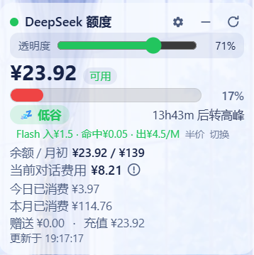

# dsh-deepseek-quota-bar

DeepSeek API 额度**血条**插件 for [DeepSeek Harness (dsh)](https://github.com/deepseek-ai/deepseek-harness) web GUI：
右下角悬浮卡片，血条直观显示「余额 / 本月额度」，并展示今日与本月使用量（官方数据优先）。

A floating bottom-right widget for the dsh web GUI: a blood-bar of your remaining
DeepSeek API balance vs the month-opening balance, plus today's and this month's
spend (official platform data when configured).



## 功能 Features

- 🩸 **血条**：剩余比例 = 当前余额 / 月初余额快照（≥50% 绿 / ≥20% 橙 / <20% 红）
- 📅 **今日/本月使用量**：配置 `DEEPSEEK_PLATFORM_TOKEN` 后为官方精确数据；未配置时自动降级为余额差值估算
- 💬 **当前对话费用**：按官方价格表对会话日志逐条计价（每条消息按**当时的**政策与峰谷状态），含安装前历史
- 🕐 **峰谷时段提醒**：时段徽标（工作日 09:00-12:00 / 14:00-18:00 为高峰，**周末全天低谷**）+ 距下次切换倒计时 + 当前模型单价（Flash/Pro 点击切换）
- 📈 **官方政策自动跟随**：单价由宿主按官方政策时间表（含 2026-08-17 峰谷、08-23 周末低谷、09-10 flash 降价）实时计算，价格调整无需更新插件
- ⚙️ **可调透明度**：设置按钮 + 滑块（0-100%），背景不透明度可调并持久化
- 🖱️ **可拖动**：按住卡片任意位置拖动，位置持久化（localStorage）
- 📉 **可折叠**：一键折叠为只显示血条的迷你卡，再点展开
- 🌗 跟随浅色/深色主题
- ⏱️ 余额每 60s 自动刷新，支持手动刷新

## 安装 Install

```sh
dsh plugin --profile web add dsh-deepseek-quota-bar
# 或从 GitHub 安装：
dsh plugin --profile web add github:jiangli07/dsh-deepseek-quota-bar
```

安装后重启 `dsh web`，打开页面强刷（Ctrl+Shift+R），右下角出现卡片。

## 兼容性 Compatibility

| dsh | 会话日志回放接口 | 当前会话判定 |
|---|---|---|
| 0.1.0-rc.6 ~ 0.1.x | `readStoredRevision` + `readRaw` | `SessionListState.current` |
| 0.2.x | `stat` + `open(id, "read")` | `retainedBy.mainView > 0` |

两代接口均在运行时特性探测，同一份 `lib/` 同时运行在 0.1.x 与 0.2.x 上，无需按版本分叉。

## 配置 Configuration

| 凭证 | 必需 | 说明 |
|---|---|---|
| `DEEPSEEK_API_KEY` | ✅ | 与 harness 同一个 Key（设置 → 模型 页面填写） |
| `DEEPSEEK_PLATFORM_TOKEN` | 可选 | platform.deepseek.com 的 `userToken`：F12 → Console → 执行 `JSON.parse(localStorage.getItem('userToken')).value`，把值写入 `~/.dsh/.credentials.yaml` |

凭证是热读取的：配置后无需重启，下一次刷新即生效。

## 工作原理 How it works

- **余额**：`GET https://api.deepseek.com/user/balance`
- **今日/本月（官方）**：`GET https://platform.deepseek.com/api/v0/usage/cost?month=&year=`（与平台控制台同源）
- **今日/本月（估算兜底）**：月初/当日期初余额快照差值，状态持久化于 `~/.dsh/storages/deepseek-quota-bar.json`
- **血条分母**：本月 1 号首次观测到的余额快照；月中新装时用「当前余额 + 本月官方消耗」反推
- **对话费用**：订阅 `session/event` 实时计价 + 持久化日志全量回放（含重启前历史；回放接口按 dsh 版本特性探测）

## 开发 Development

```sh
git clone https://github.com/jiangli07/dsh-deepseek-quota-bar.git
cd dsh-deepseek-quota-bar
dsh plugin --profile web add .
```

注意：修改 `lib/client.js` 后需重启 `dsh web`（bundle 引导哈希重新生成）再强刷页面。

## 许可 License

MIT。Fork 自 [yingjunnan/dsh-deepseek-quota](https://github.com/yingjunnan/dsh-deepseek-quota)（MIT）；
定价引擎参考 [dsh-web-billing](https://github.com/bpc-oss/dsh-web-billing)（MIT）。
